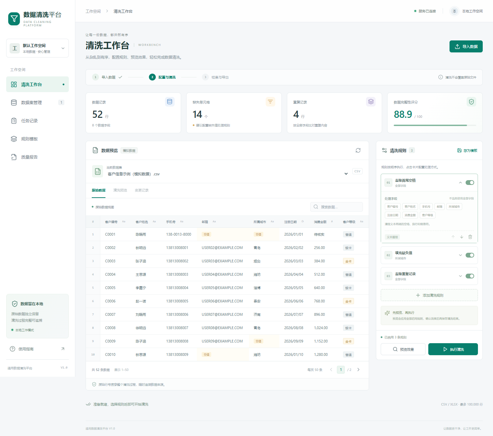
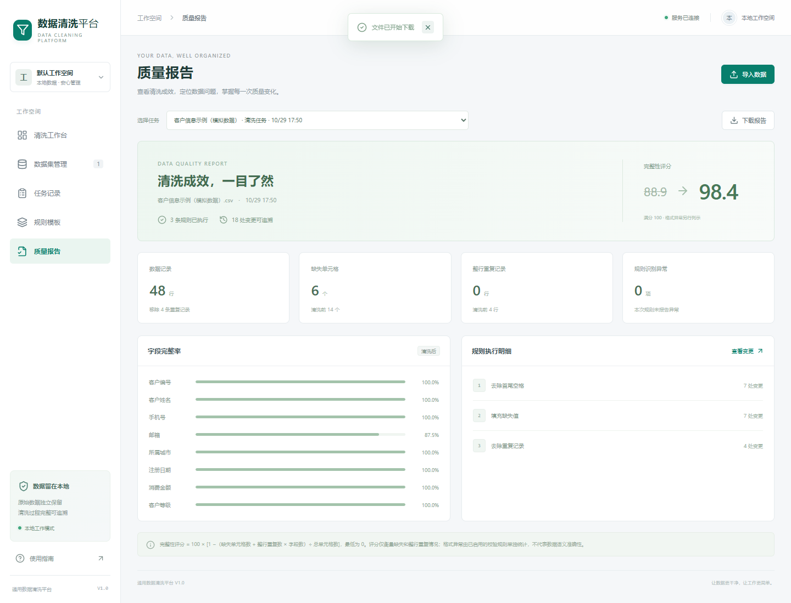

# 通用数据清洗平台 V1.0

一个可在本地运行的通用表格数据清洗平台，采用 **左侧菜单 + 数据表格预览 + 规则配置面板**。支持导入、质量检查、配置规则、预览、执行、结果检查及导出，原始数据始终独立保留。

## 快速启动（Windows）

环境：Python 3.12+、Node.js 22.12+（或 24 LTS）、Git。

```powershell
git clone https://github.com/scx520/data_clean.git
cd data_clean
powershell -ExecutionPolicy Bypass -File .\start.ps1
```

也可双击 `start.bat`。首次启动安装依赖并构建前端；完成后访问 **http://127.0.0.1:8000**。保持启动窗口运行，Ctrl+C 停止服务。

已有构建且没有前端变更时：`powershell -ExecutionPolicy Bypass -File .\start.ps1 -SkipBuild`。

端口被占用时：`powershell -ExecutionPolicy Bypass -File .\start.ps1 -Port 8001`。

## 已实现功能

- **清洗工作台**：数据集选择、分页与搜索、缺失值高亮、原始数据 / 清洗预览 / 变更 / 异常视图。
- **数据导入**：CSV（UTF-8 / GB18030）与 XLSX，第一个工作表，文本编号保留前导零。
- **7 类规则**：去首尾空格、固定值填充缺失、指定字段去重、文本替换、英文大小写、日期 / 数值转换、手机号 / 邮箱格式校验。
- **规则管理**：字段多选、参数配置、启停、上下排序；修改规则会清除过期预览，要求重新计算。
- **清洗任务**：后台执行、状态轮询、历史记录、原始行号追溯。
- **规则模板**：命名、保存、应用、删除；应用前检查字段是否匹配。
- **质量报告**：清洗前后完整性评分、缺失 / 重复统计、字段完整率、规则执行明细。
- **结果导出**：CSV / Excel 清洗结果，CSV 变更记录与异常记录，JSON 质量报告。
- **数据持久化**：SQLite 元数据与 JSON 数据文件；服务重启后可继续查看历史。

首次运行自动生成一份 **52 行模拟客户数据**，不含真实客户信息。进入「使用指南」可查看操作流程。





## 开发

后端：

```powershell
python -m venv .venv
.\.venv\Scripts\python.exe -m pip install -r backend\requirements.txt
.\.venv\Scripts\python.exe -m uvicorn app.main:app --app-dir backend --reload --host 127.0.0.1 --port 8000
```

前端（另开终端）：

```powershell
cd frontend
npm ci
npm run dev
```

访问 http://127.0.0.1:5173；开发服务将 `/api` 请求代理到 8000 端口。API 文档：http://127.0.0.1:8000/docs。

生产模式：`npm run build` 后由 FastAPI 同时提供网页和 API，默认仅监听本机。

## 验证

```powershell
cd backend
..\.venv\Scripts\python.exe -m pytest -q
cd ..\frontend
npm run build
npx playwright install chromium
npm run test:e2e
```

浏览器测试自动启动独立服务和临时数据库，不读取本地工作数据；测试内容包括预览、执行、导出、模板复用、上传、历史查看及移动布局。

## 数据与使用范围

- 第一版用于本地 / 单工作空间，暂无登录权限、多人协作、数据库直连及分布式执行。
- 每个文件最多 20 MB、100,000 行、200 列；长任务处理速度取决于本机资源。
- 预览对全部数据计算，只展示前 200 行、前 500 条变更 / 异常；正式执行后可分页查看完整结果。
- 原始行号是导入后的记录序号，不是 Excel 物理行号；CSV 全空行不作为数据记录。
- 日期转换采用常见格式自动识别，建议输入 `YYYY-MM-DD`，歧义日期应先统一格式；Excel 中原本以数值保存且只通过显示格式补零的编号，不能还原前导零。
- 格式校验只标记异常，转换失败保留原值。未启用的校验规则不会自动报告格式问题。
- 完整性评分根据缺失单元格和整行重复记录计算，不能代表业务语义准确性；计算方法在报告页明确展示。
- 数据保存在 `.data/`，已从 Git 排除；请备份整个目录以保留数据、模板和任务。可用 `DATA_CLEAN_HOME` 环境变量指定其他存储位置。
- 导出时对可能被电子表格执行为公式的文本进行转义。

## 项目结构

```text
backend/app/       API、清洗引擎、SQLite 与文件存储
backend/tests/     清洗逻辑与接口测试
frontend/src/      Vue 3 + TypeScript 交互界面
frontend/e2e/      Playwright 浏览器测试
docs/             操作说明、设计说明及版本记录
start.ps1         Windows 安装、构建、启动入口
```

技术栈：Vue 3、TypeScript、Vite、Lucide 图标、FastAPI、Pandas、openpyxl、SQLite。

开发说明和操作流程见 [docs/使用说明.md](docs/使用说明.md)；系统设计见 [docs/系统设计.md](docs/系统设计.md)。
数据清洗平台
