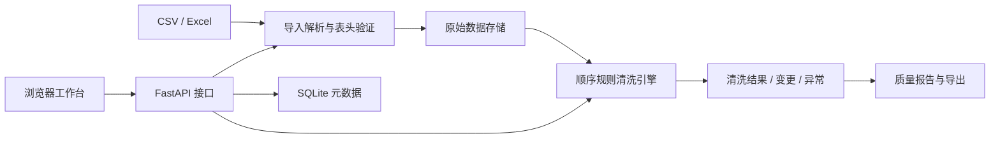

# 通用数据清洗平台 V1.0 系统设计

## 软件目标

面向结构化表格的日常整理，提供可配置规则、处理预览、异步任务、完整变更追溯与质量报告。第一版以本地单工作空间运行，不依赖外部云服务。

## 架构



前端：Vue 3、TypeScript、Vite。使用浏览器 Fetch 调用 API，开发阶段通过 Vite 代理，构建后由 FastAPI 提供静态文件。图标使用 Lucide。

界面主色使用移动蓝 `#0085D0`，配合蓝白背景、浅蓝选中态和蓝色质量图表；缺失与异常提示保留独立的警示色。主色、深色与浅色由 CSS 主题变量统一控制。

后端：FastAPI 提供上传、预览、任务、结果、导出与模板接口。Pandas / openpyxl 处理 Excel 和格式转换；CSV 使用标准库解析。后台任务由 FastAPI BackgroundTasks 在本机服务进程中执行。

存储：SQLite 保存数据集、任务、模板元数据；JSON 文件保存原始表格和结果，写入采用临时文件替换。所有数据库操作使用参数绑定。每次操作独立连接 SQLite，避免跨线程复用连接。

预览完整结果单独保存在 `.data/previews/`，使用随机标识访问，24 小时过期；启动和生成新预览时清理过期缓存。预览不创建正式任务，源数据不参与写入。完整结果在服务器分页与搜索，避免浏览器误把初次响应的部分记录当作全部结果。

## 功能模块

| 模块 | 主要职责 | 入口 |
| --- | --- | --- |
| 清洗工作台 | 选择数据集，配置规则，分页搜索、预览与结果检查 | 前端 workspace 页面 |
| 数据集管理 | 导入、列表、数据概况、原始记录读取 | `/api/datasets` |
| 规则引擎 | 验证参数，顺序执行，记录变更与异常 | `backend/app/engine.py` |
| 任务管理 | 提交、状态查询、结果保存和历史读取 | `/api/tasks` |
| 模板管理 | 保存、应用前字段检查、删除 | `/api/templates` |
| 质量报告 | 清洗前后统计、字段完整率与规则处理明细 | 任务 summary 与报告页面 |
| 数据导出 | CSV / XLSX 结果、CSV 明细、JSON 报告 | `/api/tasks/{id}/export` |
| 本地聚类分析 | 数值 / 中文文本特征提取、分组标签、组别概况 | `backend/app/analysis.py` |

聚类规则 `type=cluster`，参数包括 `mode=numeric/text`、`clusters=2..12`、`output` 新列名。数值字段逐值验证并标准化，10,000 条以内使用 KMeans，更大数据使用 MiniBatchKMeans；文本使用字符 1–3 gram TF-IDF（最多 5,000 特征）和 MiniBatchKMeans。固定随机种子，限制原生计算线程，按源记录首次出现顺序统一分组标签。机器学习依赖只在使用聚类规则时加载。

分析输出追加新列，原始行号和字段保持独立。每行生成 action=annotate 的标签变更；未参与行生成异常说明。规则统计增加 annotated_cells，结果与任务摘要增加 analyses（组别规模、占比、均值或文字特征），报告导出保留完整分析概况。质量统计仍只基于原始字段，避免新增完整标签人为抬高评分。

## 数据结构

### datasets

`id` 主键、`name` 名称、`row_count` 行数、`column_count` 列数、`created_at` 导入时间、`source` 来源（demo / import）、`columns_json` 字段数组。

`deleted_at` 为空表示可用数据集，有值表示已移入回收站。旧数据库启动时通过检查表结构添加该列，保留所有旧记录和文件。导入按明确列名插入，兼容迁移后的表结构。

删除仅设置回收站时间戳，恢复将其清空；原始文件、历史任务与结果文件保留。任务提交与删除使用 SQLite 写事务互斥校验：有 pending / running 任务时不允许删除，已删除数据集不允许新建任务或预览。历史原始数据读取允许访问已删除记录，并在界面标识。

数据文件：`.data/datasets/{id}.json`，包含 columns 和 rows。每行额外带 `_row_id`，作为内部稳定标识；导出业务数据时不包含该内部字段。导入禁止用户表头使用 `_row_id`。

### tasks

`id` 主键、`name` 任务名、`dataset_id` 数据集、`dataset_name` 名称快照、`status` 状态、`created_at` 创建时间、`finished_at` 完成时间、`rules_json` 规则快照、`summary_json` 质量与计数、`error` 失败说明。

状态流转：pending → running → success / failed。重启时将未完成任务置为 failed，防止历史任务永远显示执行中。结果文件：`.data/results/{id}.json`。

### templates

`id` 主键、`name` 名称、`description` 说明、`rules_json` 完整规则列表、`created_at` 保存时间。

### Rule

```json
{
  "id": "规则标识",
  "type": "fill",
  "enabled": true,
  "fields": ["所属城市"],
  "options": { "value": "未填写" }
}
```

预览与正式执行共享同一个 clean 函数。引擎复制原始记录，在副本上修改；去重只比较业务字段，不比较内部行号。每项实际修改记录行号、字段、原值、新值、规则名和操作类型。

## API 概要

| 方法 | 路径 | 作用 |
| --- | --- | --- |
| GET | `/api/health` | 服务状态、版本 |
| GET / POST | `/api/datasets` | 列表 / 上传 |
| GET | `/api/datasets?deleted=true` | 回收站数据集列表 |
| DELETE | `/api/datasets/{id}` | 移入回收站，保留关联任务和结果 |
| POST | `/api/datasets/{id}/restore` | 从回收站恢复 |
| GET | `/api/datasets/{id}` | 分页原始数据、搜索、质量 |
| POST | `/api/datasets/{id}/preview` | 完整计算，返回统计、实际字段和预览标识 |
| GET | `/api/previews/{id}` | 预览结果、变更、异常的完整分页与搜索 |
| POST | `/api/datasets/{id}/tasks` | 提交清洗任务，返回任务编号 |
| GET | `/api/tasks` | 任务列表 |
| GET | `/api/tasks/{id}` | 单任务状态与摘要 |
| GET | `/api/tasks/{id}/result` | 按 rows / changes / issues 分页与搜索 |
| GET | `/api/tasks/{id}/export` | 按种类、格式下载 |
| GET / POST | `/api/templates` | 模板列表 / 保存 |
| DELETE | `/api/templates/{id}` | 删除模板 |

完整参数与请求模型由 FastAPI 自动生成，见运行后的 `/docs`。

## 一致性与交互

- 原始数据、规则快照、清洗结果分开保存，历史结果不随当前工作台规则变化。
- 修改当前规则会清除当前结果视图，避免用户将旧结果视为新配置的计算结果。
- 导入、预览、执行时对相应按钮禁用，防止重复提交和执行期间修改规则。
- 原始与结果查询使用递增请求标识，旧请求晚返回时不覆盖新视图。
- 初始预览响应保留有限记录以控制响应大小，页面通过预览标识获取完整分页；质量、总数与变更计数均基于全量计算。
- 预览与历史结果显示原始 / 保留 / 移除行数，执行明细包含实际处理字段；字段选择和启用开关以移动蓝明显标识。
- 报告明确说明评分边界；异常项来自规则执行时的检查，同一记录可有多项异常。

## 当前边界与后续方向

当前为单进程本机工作台。JSON 数据和变更明细全部在内存中处理；20 MB 文件上限不等于内存占用上限，大量长文本和多规则任务可能需要较多内存。任务尚无取消、断点恢复与多进程队列。

后续可按需求增加分块处理、数据库导入、任务队列、账号权限、数据字典映射和业务校验。升级时应保留稳定行标识、规则快照及原始内容独立保存的设计。
